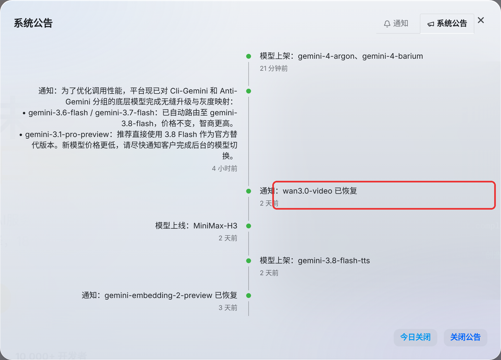
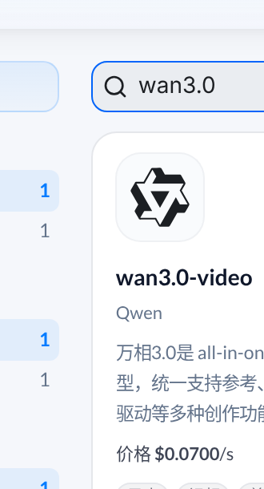
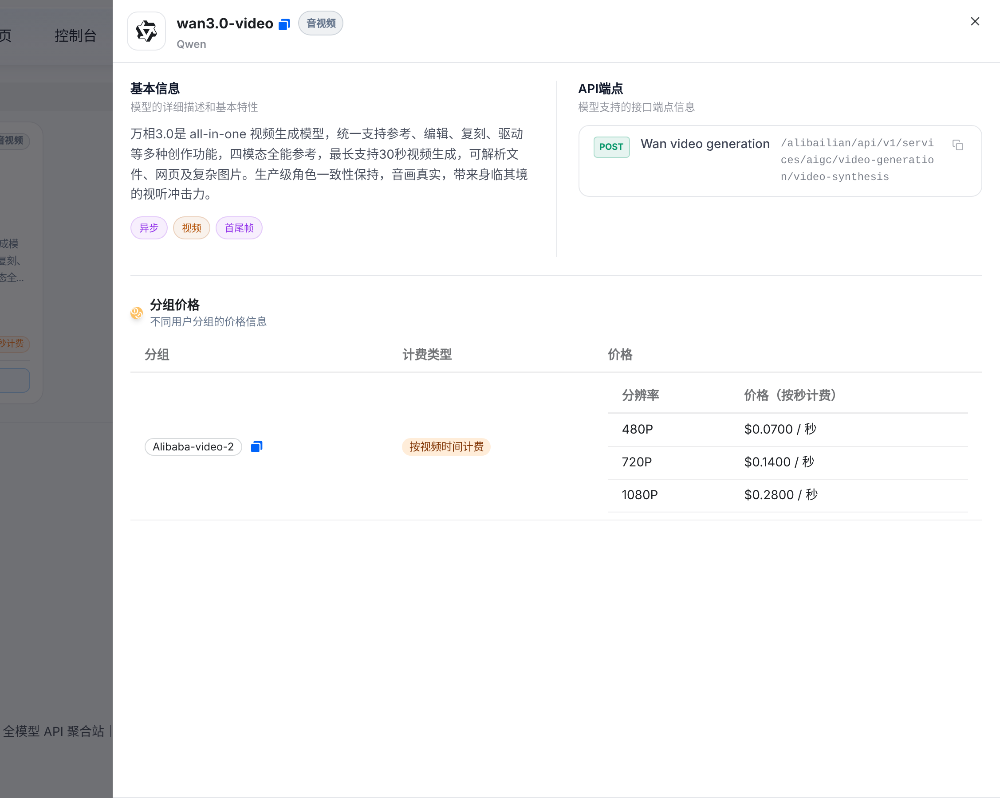

> 在线阅读（GitHub Pages）：https://maynor996.github.io/wan30-video-tryallapi/

# wan3.0-video 回来了！tryallapi 万相 3.0 视频生成已恢复

> 备选标题：
> 1. wan3.0-video 回来了！tryallapi 万相 3.0 视频生成已恢复（✅ 采用）
> 2. 维护一天就回归：wan3.0-video 恢复可用，按秒计费价格一览
> 3. 做视频的看过来：万相 3.0 在 tryallapi 又能调了


前两天在 tryallapi 跑视频的朋友应该注意到了：10 月 9 日下午站内发了通知，**wan3.0-video 维护中，暂时下线**。好消息是，10 月 10 日晚上 20:41 公告更新——**通知：wan3.0-video 已恢复**。



## wan3.0-video 是啥？

以下是 tryallapi 模型广场上的**站内描述**（原文照搬，我没加料）：

> 万相3.0是 all-in-one 视频生成模型，统一支持参考、编辑、复刻、驱动等多种创作功能，四模态全能参考，最长支持30秒视频生成，可解析文件、网页及复杂图片。生产级角色一致性保持，音画真实，带来身临其境的视听冲击力。

站内标签：**异步 / 视频 / 首尾帧**，归类在 Qwen 供应商下。实际效果、生成速度这些，大家自己跑一条最直观，以站内说明为准。



## 价格：按秒、按分辨率

分组 Alibaba-video-2，按视频时间计费（截图时间 2026-10-13，以页面为准）：

| 分辨率 | 价格（按秒） |
|---|---|
| 480P | $0.0700 / 秒 |
| 720P | $0.1400 / 秒 |
| 1080P | $0.2800 / 秒 |

小建议：先用 480P 把 prompt 和镜头调顺，满意了再上 1080P 出成片，能省不少。



## 适合什么场景？

结合站内描述的“参考、编辑、复刻、驱动”和“首尾帧”标签：

- 短视频/广告素材：给首帧、尾帧，让模型补中间的过渡；
- 角色类内容：站内描述强调“角色一致性保持”；
- 素材二创：参考已有画面做编辑、复刻。

## 怎么在 tryallapi 调用？

它**不是** OpenAI chat 接口，详情页显示的端点类型是 **Wan video generation**：

```
POST https://tryallapi.com/alibailian/api/v1/services/aigc/video-generation/video-synthesis
```

这是异步任务：先提交拿到任务 ID，再轮询结果。提交示例（结构参照阿里云百炼的视频合成格式，**具体字段以站内 API 文档为准**）：

```bash
curl https://tryallapi.com/alibailian/api/v1/services/aigc/video-generation/video-synthesis \
  -H "Authorization: Bearer $TRYALLAPI_KEY" \
  -H "Content-Type: application/json" \
  -H "X-DashScope-Async: enable" \
  -d '{
    "model": "wan3.0-video",
    "input": {"prompt": "一只橘猫在雨夜的霓虹街头慢慢走过，电影感镜头"},
    "parameters": {"resolution": "720P"}
  }'
```

Python 版本思路一样：

```python
import os, requests

r = requests.post(
    "https://tryallapi.com/alibailian/api/v1/services/aigc/video-generation/video-synthesis",
    headers={"Authorization": f"Bearer {os.environ['TRYALLAPI_KEY']}",
             "X-DashScope-Async": "enable"},
    json={"model": "wan3.0-video",
          "input": {"prompt": "海边日落，延时摄影"},
          "parameters": {"resolution": "480P"}},
)
print(r.json())  # 拿到任务 ID 后按站内文档查询任务结果
```

> 查询任务的路径、首尾帧/参考图的字段名，都以站内 API 文档为准。

## 结尾

视频模型最怕维护时断档，现在恢复了，之前排着的活可以接着跑了。还没注册的话，走这里：👉 [https://tryallapi.com/register?aff=5A6A](https://tryallapi.com/register?aff=5A6A)

建令牌的时候记得选 Alibaba-video-2 分组。祝出片顺利～